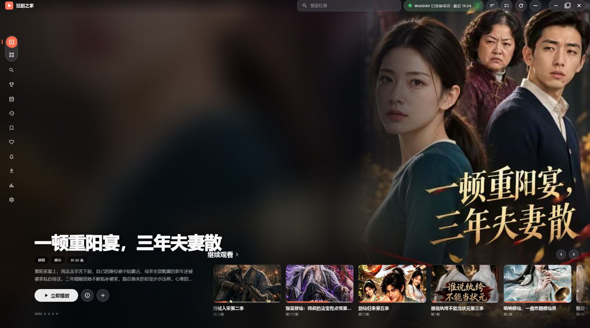
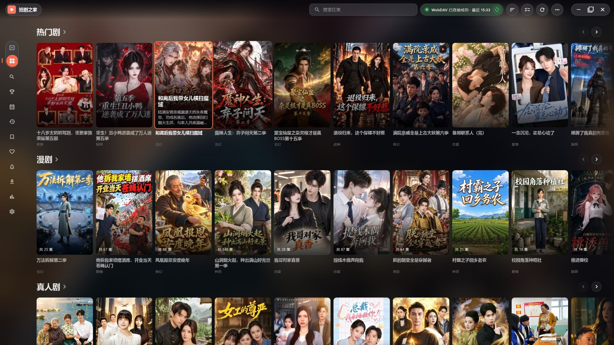
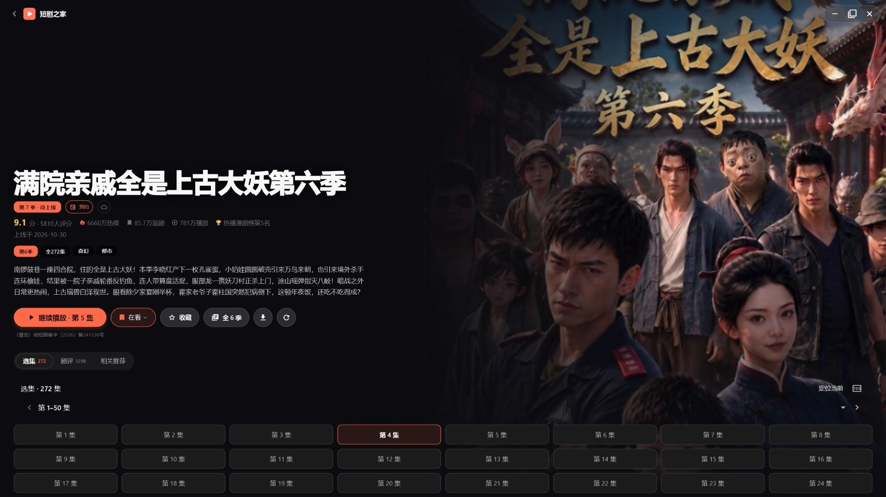
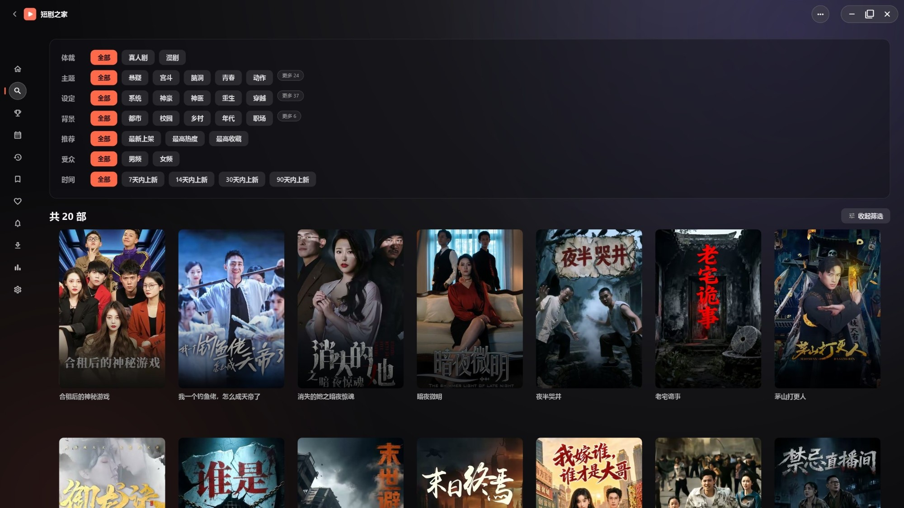
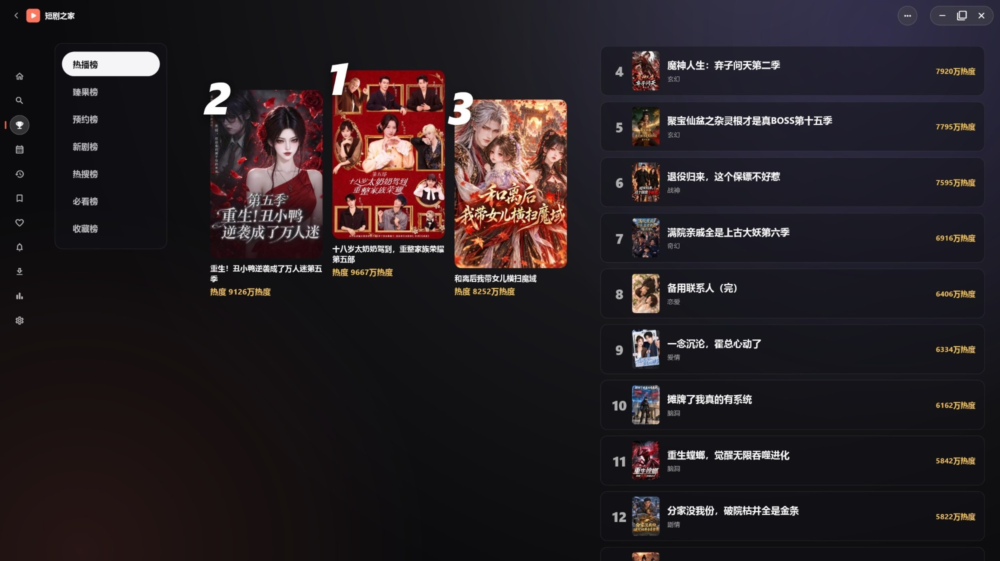
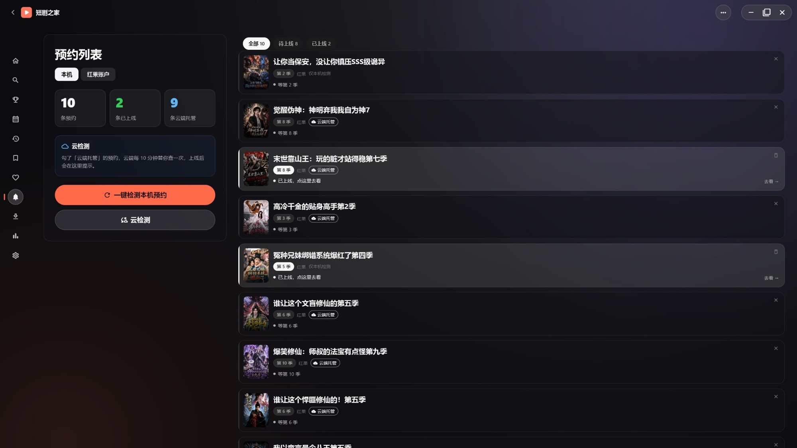
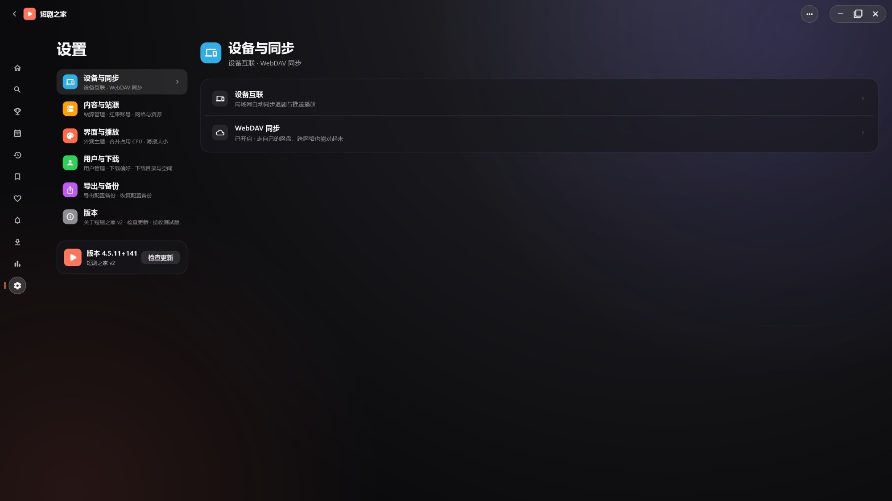

# 短剧之家 v2（红果）｜Windows 下载

在 Windows 电脑上找剧、接着上次看。**内容来自红果**，支持搜索、收藏、选集、倍速、自动连播、下载缓存，也能和手机版互相同步收藏与观看进度。

**免费使用 · 当前版本 4.5.14+144**

[**⬇ 下载 Windows 安装程序（推荐）**](https://github.com/jackherex/duanjuzhijia-down-pc/releases/latest)　｜　[全部版本](https://github.com/jackherex/duanjuzhijia-down-pc/releases)

适用于 **Windows 10 / 11（64 位）**，安装程序约 **85.5 MB**，免安装版约 **117.8 MB**。
普通使用**只需要下载 `.exe`**（或 `.zip`），不需要下载页面里的其它文件。

> 上面的按钮**始终指向最新版**，以后发新版不用回来改链接。

## 演示页面

电脑版 4.5.14 全新界面：

**首页轮播**



**推荐：热门剧 / 漫剧 / 真人剧 / AI 剧分类**



**剧集详情与选集**



**找剧：按体裁、主题、设定筛选**



**排行榜**



**预约下一季，上线自动提醒**



**设置**



## 三步开始使用

1. 点上面的按钮，打开最新版下载页，下载带 `setup.exe` 的那个文件（**推荐**）。
   想要免安装版就下带 `.zip` 的那个 —— 解压到任意文件夹，双击里面的 `duanjuzhijia2.exe` 就能用，不用安装。别的文件不用管。
2. 双击运行。Windows 可能弹出蓝色提示「Windows 已保护你的电脑」—— 点「更多信息」→「仍要运行」即可。（本软件没有购买微软的代码签名证书，所以会这样提示，属正常现象。）
3. 装好后打开，搜索剧名，或从首页点进去播放。

## 常见问题

**提示「Windows 已保护你的电脑」或「未知发布者」**
正常现象，原因见上一步。本软件未购买代码签名证书。请**只从本页面下载**，不要用来路不明的安装包。

**需要额外装什么吗？**
不需要，装完直接用。

**电脑和手机之间怎么同步？**
在「设置」里配置「设备互联」或 WebDAV（坚果云、群晖、OpenList 都行），两台设备填**同一套**配置。电脑版还能在设置页生成二维码，用手机版扫一下自动填好。

**杀毒软件报警？**
这类没有数字签名的免费软件被误报比较常见。如果不放心，可以先下载免安装版试用。

## 使用反馈

遇到问题请到 [反馈区](https://github.com/jackherex/duanjuzhijia-down-pc/issues) 说明：**Windows 版本、软件版本**（设置页最下方能看到），以及**操作步骤和实际现象**。有想要的功能也可以提。

## 下载与安装说明

### `duanjuzhijia2-4.5.14+144-setup.exe`（安装程序，推荐）

大小 `89647493` 字节。SHA-256：

```
0e986055d29bc85fd8c4a385cf480b925725403b9d820ca35aedca9db58426eb
```

### `duanjuzhijia2-4.5.14+144-windows-x64.zip`（免安装版）

大小 `123507325` 字节。SHA-256：

```
cd503b03440ae879d8620e1d0ab70ca6a330006333843c0e4f28500a610ba707
```

这两串数字用来核对文件有没有下载完整，**不能代替身份认证**。

> ⚠️ 上面这组校验值对应的是**本次说明写就时的最新版**。如果下载页上已经有更新的版本，
> 请以页面上的为准（按钮永远指向最新版）。

[全部版本与更新内容](https://github.com/jackherex/duanjuzhijia-down-pc/releases)

## 关于本仓库

这里是**公开下载页**：只放安装包，供大家直接下载。应用免费使用。
剧中内容来自红果，相关品牌与内容归各自权利方所有。

本项目二改自红果鉴开源项目，仅供学习交流。
